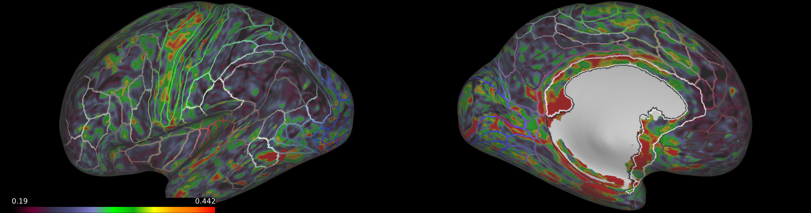

<p align="center">
  
</p>

<h1 align="center">Cortex Tissue Mapping</h1>

<p align="center">
  Diffusion, myelin, qMRI and ROI measures mapped onto the cortical midthickness surface, plus tools to resample, smooth and average the resulting cortexmaps across subjects.
</p>

<p align="center">
  <a href="https://github.com/brainlife/abcd-spec"></a>
  <a href="https://doi.org/10.25663/brainlife.app.737"></a>
  <a href="LICENSE"></a>
</p>

> **This branch, `endpoints-fsaverage-v1.0`, is the deprecated brainlife.io App Map tract endpoint ROIs to cortical surface for quantitative analyses - fsaverage (No smoothing)** ([doi:10.25663/brainlife.app.737](https://doi.org/10.25663/brainlife.app.737)). It is kept so earlier results stay reproducible. Use **Map tract endpoint ROIs to cortical surface for quantitative analyses - fsaverage** ([doi:10.25663/brainlife.app.767](https://doi.org/10.25663/brainlife.app.767)) instead. The other Apps in this repository are listed under **Versions on brainlife.io** below.

## At a glance

<!-- brainlife-app:begin (generated from the App manifest; edit the manifest, not this block) -->

> **This app will map volumated measure files (i.e. tensor, NODDI) to the cortical surface following Fukutomi et al (2018; 10.1016/j.neuroimage.2018.02.017) using Connectome Workbench.**

| | |
|---|---|
| **Inputs** | `neuro/rois` · `neuro/cortexmap` (optional) |
| **Outputs** | `neuro/cortexmap` · `raw` |
| **Container** | `brainlife/connectome_workbench:1.5.0` |
| **Resources** | 8 CPUs · 2.5 h walltime |
| **Requires** | `FREESURFER_LICENSE` |
| **Run it** | [doi.org/10.25663/brainlife.app.737](https://doi.org/10.25663/brainlife.app.737) |

#### Inputs

| Input | Datatype | Required | Description |
|---|---|---|---|
| `rois` | `neuro/rois` (warped) | yes |  |
| `cortexmap` | `neuro/cortexmap` | no | If cortexmap datatype has already been generated, update the datatype with the endpoint ROIs |

#### Outputs

| Output | Datatype | Description |
|---|---|---|
| `cortexmap` | `neuro/cortexmap` | The cortexmap output, containing the surfaces and mapped data |
| `raw` | `raw` | A directory containing all of the derivatives generated. Useful for QA and debugging |

<details>
<summary><b>Parameters</b> (2)</summary>

| Parameter | Type | Default | Description |
|---|---|---|---|
| `fsurfparc` | enum | `aparc.a2009s` | Parcellation from freesurfer wanted to for future stats Options: `aparc`, `aparc.a2009s`, `aparc.DKTatlas`. |
| `freesurfer` | enum | `fsaverage` | Options: `fsaverage`, `fsaverage3`, `fsaverage4`, `fsaverage5`, `fsaverage6`. |

</details>

<!-- brainlife-app:end -->

## How it works

The mapping Apps follow Fukutomi et al. (2018) and the Human Connectome Project minimal preprocessing pipelines (Glasser et al. 2013), using Connectome Workbench. From a FreeSurfer run they build white, pial, midthickness (the surface halfway between white and pial) and inflated GIFTI surfaces, then sample each volumetric measure within the cortical ribbon onto the midthickness surface, with a Gaussian kernel scaled to the DWI voxel size. Surfaces are written in native space and, when a nonlinear warp to a template is provided, also in template (MNI) space. The chosen FreeSurfer surface parcellation (default `aparc.a2009s`) is converted to GIFTI labels. Most variants also compute the b0 temporal SNR from the DWI and mask out cortical vertices with low SNR.

The code was adapted from the HCP [PostFreeSurfer pipeline](https://github.com/Washington-University/HCPpipelines/blob/master/PostFreeSurfer/scripts/FreeSurfer2CaretConvertAndRegisterNonlinear.sh) and the RIKEN Brain Connectomics Imaging Laboratory's [NoddiSurfaceMapping](https://github.com/RIKEN-BCIL/NoddiSurfaceMapping) repository for use on brainlife.io. Every App reads and writes the `neuro/cortexmap` datatype, so they can be chained: create or map measures per subject, resample to a standard mesh, smooth, then average or sum across subjects.

## Versions on brainlife.io

Each row is a separate App on brainlife.io, built from its own branch of this repository.

**Mapping measures to the cortical surface**

| App | Workbench | Branch | Run it | Status |
|---|---|---|---|---|
| Cortex Tissue Mapping (Native & Template Space) — tensor/DKI, optional NODDI | 1.5.0 | [`v1.3-snr-input`](https://github.com/brainlife/app-cortex-tissue-mapping/tree/v1.3-snr-input) | [doi:10.25663/brainlife.app.379](https://doi.org/10.25663/brainlife.app.379) | current |
| Cortex Tissue Mapping (Native & Template Space) (Noddi) | 1.5.0 | [`v1.3-snr-input`](https://github.com/brainlife/app-cortex-tissue-mapping/tree/v1.3-snr-input) | [doi:10.25663/brainlife.app.380](https://doi.org/10.25663/brainlife.app.380) | current |
| Cortex Tissue Mapping (Native Space) — tensor/DKI, optional NODDI | 1.5.0 | [`v1.3-snr-input`](https://github.com/brainlife/app-cortex-tissue-mapping/tree/v1.3-snr-input) | [doi:10.25663/brainlife.app.381](https://doi.org/10.25663/brainlife.app.381) | current |
| Cortex Tissue Mapping (Native Space) (Noddi) | 1.5.0 | [`v1.3-snr-input`](https://github.com/brainlife/app-cortex-tissue-mapping/tree/v1.3-snr-input) | [doi:10.25663/brainlife.app.382](https://doi.org/10.25663/brainlife.app.382) | current |
| Cortex Tissue Mapping (Native Space) - Gray Matter Density | 1.5.0 | [`gmd-v1.1`](https://github.com/brainlife/app-cortex-tissue-mapping/tree/gmd-v1.1) | [doi:10.25663/brainlife.app.431](https://doi.org/10.25663/brainlife.app.431) | current |
| Cortex Tissue Mapping (Native Space) - Myelin Mapping (T1w/T2w ratio) | 1.5.0 | [`t1-t2-ratio-v1.1`](https://github.com/brainlife/app-cortex-tissue-mapping/tree/t1-t2-ratio-v1.1) | [doi:10.25663/brainlife.app.479](https://doi.org/10.25663/brainlife.app.479) | current |
| Cortex Tissue Mapping (Native & Template Space) - Myelin Mapping (T1w/T2w ratio) | 1.5.0 | [`t1-t2-ratio-v1.1`](https://github.com/brainlife/app-cortex-tissue-mapping/tree/t1-t2-ratio-v1.1) | [doi:10.25663/brainlife.app.480](https://doi.org/10.25663/brainlife.app.480) | current |
| Cortex Tissue Mapping (Native Space) - Myelin Mapping (T1w/T2w ratio) (No SNR masking) | 1.5.0 | [`t1-t2-ratio-v1.1-nosnr`](https://github.com/brainlife/app-cortex-tissue-mapping/tree/t1-t2-ratio-v1.1-nosnr) | [doi:10.25663/brainlife.app.515](https://doi.org/10.25663/brainlife.app.515) | current |
| Cortex Tissue Mapping (Native & Template Space) - Myelin Mapping (T1w/T2w ratio) (No SNR masking) | 1.5.0 | [`t1-t2-ratio-v1.1-nosnr`](https://github.com/brainlife/app-cortex-tissue-mapping/tree/t1-t2-ratio-v1.1-nosnr) | [doi:10.25663/brainlife.app.516](https://doi.org/10.25663/brainlife.app.516) | current |
| Cortex Tissue Mapping (Native & Template Space) - qMRI | 1.5.0 | [`qmri-v1.1`](https://github.com/brainlife/app-cortex-tissue-mapping/tree/qmri-v1.1) | [doi:10.25663/brainlife.app.560](https://doi.org/10.25663/brainlife.app.560) | current |
| Cortex Tissue Mapping (Native Space) - qMRI | 1.5.0 | [`qmri-v1.1`](https://github.com/brainlife/app-cortex-tissue-mapping/tree/qmri-v1.1) | [doi:10.25663/brainlife.app.561](https://doi.org/10.25663/brainlife.app.561) | current |
| Cortex Tissue Mapping (Native Space) - qMRI (No SNR masking) | 1.5.0 | [`qmri-v1.1-nosnr`](https://github.com/brainlife/app-cortex-tissue-mapping/tree/qmri-v1.1-nosnr) | [doi:10.25663/brainlife.app.562](https://doi.org/10.25663/brainlife.app.562) | current |
| Create structural derivatives for cortexmap datatype | 1.5.0 | [`create-cortexmap-datatype-v1.0`](https://github.com/brainlife/app-cortex-tissue-mapping/tree/create-cortexmap-datatype-v1.0) | [doi:10.25663/brainlife.app.573](https://doi.org/10.25663/brainlife.app.573) | current |

**Mapping ROIs (e.g. tract endpoints) to the cortical surface**

| App | Workbench | Branch | Run it | Status |
|---|---|---|---|---|
| Map tract endpoint ROIs to cortical surface for quantitative analyses | 1.5.0 | [`endpoints-v1.1`](https://github.com/brainlife/app-cortex-tissue-mapping/tree/endpoints-v1.1) | [doi:10.25663/brainlife.app.759](https://doi.org/10.25663/brainlife.app.759) | current |
| Map ROIs to cortical surface | 1.5.0 | [`endpoints-v1.0`](https://github.com/brainlife/app-cortex-tissue-mapping/tree/endpoints-v1.0) | [doi:10.25663/brainlife.app.736](https://doi.org/10.25663/brainlife.app.736) | available |
| Map tract endpoint ROIs to cortical surface for quantitative analyses - fsaverage | 1.5.0 | [`endpoints-fsaverage-smoothing-v1.1`](https://github.com/brainlife/app-cortex-tissue-mapping/tree/endpoints-fsaverage-smoothing-v1.1) | [doi:10.25663/brainlife.app.767](https://doi.org/10.25663/brainlife.app.767) | current |
| Map tract endpoint ROIs to cortical surface for quantitative analyses - No smoothing available | 1.5.0 | [`endpoints-v1.0`](https://github.com/brainlife/app-cortex-tissue-mapping/tree/endpoints-v1.0) | [doi:10.25663/brainlife.app.572](https://doi.org/10.25663/brainlife.app.572) | deprecated |
| **Map tract endpoint ROIs to cortical surface for quantitative analyses - fsaverage (No smoothing)** (this branch) | 1.5.0 | [`endpoints-fsaverage-v1.0`](https://github.com/brainlife/app-cortex-tissue-mapping/tree/endpoints-fsaverage-v1.0) | [doi:10.25663/brainlife.app.737](https://doi.org/10.25663/brainlife.app.737) | deprecated |

**Working with cortexmaps**

| App | Workbench | Branch | Run it | Status |
|---|---|---|---|---|
| Resample cortexmap data to a standard mesh using Connectome Workbench - fsaverage | 1.4.2b | [`resample-v1.0-fsaverage`](https://github.com/brainlife/app-cortex-tissue-mapping/tree/resample-v1.0-fsaverage) | [doi:10.25663/brainlife.app.802](https://doi.org/10.25663/brainlife.app.802) | current |
| Resample cortexmap data to a standard mesh using Connectome Workbench | 1.4.2b | [`resample-v1.0`](https://github.com/brainlife/app-cortex-tissue-mapping/tree/resample-v1.0) | [doi:10.25663/brainlife.app.551](https://doi.org/10.25663/brainlife.app.551) | current |
| Smooth data mapped to cortical surface | 1.5.0 | [`smooth-cortexmap-v1.0`](https://github.com/brainlife/app-cortex-tissue-mapping/tree/smooth-cortexmap-v1.0) | [doi:10.25663/brainlife.app.768](https://doi.org/10.25663/brainlife.app.768) | current |
| Compute average cortexmap data for group analysis | 1.4.2b | [`average-template-generation-v1.1`](https://github.com/brainlife/app-cortex-tissue-mapping/tree/average-template-generation-v1.1) | [doi:10.25663/brainlife.app.552](https://doi.org/10.25663/brainlife.app.552) | current |
| Compute summed cortexmap data for group analysis | 1.4.2b | [`sum-template-generation-v1.1`](https://github.com/brainlife/app-cortex-tissue-mapping/tree/sum-template-generation-v1.1) | [doi:10.25663/brainlife.app.774](https://doi.org/10.25663/brainlife.app.774) | current |
| Convert surface datatypes to cortexmap datatype | — | [`convert-surface-datatype`](https://github.com/brainlife/app-cortex-tissue-mapping/tree/convert-surface-datatype) | [doi:10.25663/brainlife.app.576](https://doi.org/10.25663/brainlife.app.576) | current |

## Running the App

### On brainlife.io

Pick the App that matches your measure from the tables above and open its DOI link. A typical diffusion workflow is:

1. **Map measures**: give a DWI, a FreeSurfer run, the measure volumes (tensor, NODDI, myelin map, qMRI or 5TT gray-matter density) and, for the *Native & Template Space* variants, a nonlinear warp (`neuro/transform/nifti`, e.g. from FSL Anat) with its inverse. A brain mask is optional; without one the App derives it from the mean b0. You can also pass an existing cortexmap to add measures to it.
2. **Resample** each subject's cortexmap to the standard fs_LR 32k or 164k mesh (use the *fsaverage* resample App for cortexmaps built on an fsaverage surface).
3. Optionally **smooth** the surface maps, then **average** (or **sum**, e.g. for overlapping endpoint maps) the resampled cortexmaps across subjects.

Each App archives a `neuro/cortexmap` dataset to your project; the mapping Apps also archive a `raw` dataset of intermediate files for quality assurance or figures.

### Locally

You need [Singularity/Apptainer](https://apptainer.org/), [`jq`](https://jqlang.github.io/jq/) and a [FreeSurfer license](https://surfer.nmr.mgh.harvard.edu/registration.html). The Apps run in the `brainlife/connectome_workbench` (1.4.2b or 1.5.0) container; the SNR step runs in `brainlife/fsl:5.0.9`.

1. Clone this repository and check out the branch of the App you want (for example `git checkout v1.3-snr-input`).
2. Create `config.json` with the paths to your inputs. For the tensor mapping Apps (`v1.3-snr-input`):

   ```json
   {
       "dwi": "./input/dwi/dwi.nii.gz",
       "bvals": "./input/dwi/dwi.bvals",
       "bvecs": "./input/dwi/dwi.bvecs",
       "freesurfer": "./input/freesurfer/output",
       "fa": "./input/tensor/fa.nii.gz",
       "ad": "./input/tensor/ad.nii.gz",
       "md": "./input/tensor/md.nii.gz",
       "rd": "./input/tensor/rd.nii.gz",
       "ndi": "null",
       "isovf": "null",
       "odi": "null",
       "brainmask": "null",
       "warp": "null",
       "inverse_warp": "null",
       "cortexmap": "null",
       "fsurfparc": "aparc.a2009s",
       "snr": true
   }
   ```

   The other branches use the keys listed for their App on brainlife.io; some ship a `config.json_sample` (for example `resample-v1.0-fsaverage` needs `cortexmap`, `fsaverage` and `resample_surf`).

3. Export your license and run the App:

   ```bash
   export FREESURFER_LICENSE="$(cat ~/freesurfer/license.txt)"
   ./main
   ```

### Sample data

Download a DWI, a FreeSurfer run and tensor measures from brainlife.io with the [brainlife CLI](https://github.com/brainlife/cli):

```bash
npm install -g brainlife
bl login
mkdir input
bl dataset download --id 5b96bbf2059cf900271924f3 && mv 5b96bbf2059cf900271924f3 input/
bl dataset download --id 5967bffa9b45c212bbec8958 && mv 5967bffa9b45c212bbec8958 input/freesurfer
bl dataset download --id 5c5d35e3f5d2a10052842848 && mv 5c5d35e3f5d2a10052842848 input/tensor
```

## Outputs

```text
cortexmap/cortexmap/
├── func/    measures mapped to the midthickness surface (lh./rh.<measure>.func.gii)
├── label/   FreeSurfer parcellation as GIFTI labels (lh./rh.<parc>.native.label.gii)
└── surf/    white, pial, midthickness and inflated surfaces (.surf.gii) and shape files (.shape.gii)
    └── mni/ the same surfaces in template space (Native & Template Space variants)
raw/         intermediate files (SNR, ribbon, c_ras.mat, metric/) for quality assurance and figures
```

The surfaces and measures can be viewed with the Connectome Workbench viewer (`wb_view`). Smoothed maps are added next to the originals as `<name>.smooth_<kernel>.func.gii`.

## Troubleshooting

- **`Please set FREESURFER_LICENSE in .bashrc`**: export the contents of your FreeSurfer license as `FREESURFER_LICENSE` before running `main`.
- **`lh snr failed. check logs`** (or `rh`): the b0 SNR image could not be mapped to the surface. Check that the DWI has several b0 volumes and is aligned with the FreeSurfer anatomy, or use a *No SNR masking* variant.
- **`<hemi> <measure> failed. check logs`**: the measure volumes must be in the same space as the DWI and aligned with the FreeSurfer anatomy.
- **`something went wrong. check derivatives and logs`** (resample Apps): the cortexmap must contain native midthickness surfaces and come from the FreeSurfer run you provide; for the fsaverage resample App, the `fsaverage` choice must match the mesh the cortexmap was built on.
- **Endpoints do not map completely** (endpoint Apps): set `projfrac_min` to a negative value such as `-1`.

## Citing

> [!TIP]
> If you use this App in your work, please cite the App, the software it builds on and brainlife.io (below). GitHub's **Cite this repository** button gives the App citation in APA and BibTeX.

If you use these Apps, please cite the methods they implement and brainlife.io:

- Fukutomi H, et al. Neurite imaging reveals microstructural variations in human cerebral cortical gray matter. *NeuroImage* (2018). [doi:10.1016/j.neuroimage.2018.02.017](https://doi.org/10.1016/j.neuroimage.2018.02.017)
- Glasser MF, Sotiropoulos SN, Wilson JA, et al. The minimal preprocessing pipelines for the Human Connectome Project. *NeuroImage* 80:105–124 (2013). [doi:10.1016/j.neuroimage.2013.04.127](https://doi.org/10.1016/j.neuroimage.2013.04.127)
- Map tract endpoint ROIs to cortical surface for quantitative analyses - fsaverage (No smoothing). brainlife.io App. [doi:10.25663/brainlife.app.737](https://doi.org/10.25663/brainlife.app.737)
- Fischl. FreeSurfer. *NeuroImage* 62:774-781 (2012). [doi:10.1016/j.neuroimage.2012.01.021](https://doi.org/10.1016/j.neuroimage.2012.01.021)
- Jenkinson et al. FSL. *NeuroImage* 62:782-790 (2012). [doi:10.1016/j.neuroimage.2011.09.015](https://doi.org/10.1016/j.neuroimage.2011.09.015)
- Tournier et al. MRtrix3: A fast, flexible and open software framework for medical image processing and visualisation. *NeuroImage* 202:116137 (2019). [doi:10.1016/j.neuroimage.2019.116137](https://doi.org/10.1016/j.neuroimage.2019.116137)
- Marcus et al. Informatics and Data Mining Tools and Strategies for the Human Connectome Project. *Frontiers in Neuroinformatics* 5 (2011). [doi:10.3389/fninf.2011.00004](https://doi.org/10.3389/fninf.2011.00004)
- Zhang et al. NODDI: Practical in vivo neurite orientation dispersion and density imaging of the human brain. *NeuroImage* 61:1000-1016 (2012). [doi:10.1016/j.neuroimage.2012.03.072](https://doi.org/10.1016/j.neuroimage.2012.03.072)
- Hayashi S, Caron BA, Heinsfeld AS, et al. brainlife.io: a decentralized and open-source cloud platform to support neuroscience research. *Nature Methods* 21:809–813 (2024). [doi:10.1038/s41592-024-02237-2](https://doi.org/10.1038/s41592-024-02237-2)
- Avesani P, McPherson B, Hayashi S, et al. The open diffusion data derivatives, brain data upcycling via integrated publishing of derivatives and reproducible open cloud services. *Scientific Data* 6:69 (2019). [doi:10.1038/s41597-019-0073-y](https://doi.org/10.1038/s41597-019-0073-y)

## Authors

- Brad Caron

**Contributors:** Soichi Hayashi, Franco Pestilli

## Funding

[](https://wellcome.org/)
[](https://reporter.nih.gov/project-details/11261037)
[](https://reporter.nih.gov/project-details/11411328)
[](https://reporter.nih.gov/project-details/10262925)
[](https://reporter.nih.gov/project-details/10428625)
[](https://reporter.nih.gov/project-details/10460628)
[](https://reporter.nih.gov/project-details/11140284)
[](https://www.nsf.gov/awardsearch/showAward?AWD_ID=1734853)
[](https://www.nsf.gov/awardsearch/showAward?AWD_ID=2203524)
[](https://www.nsf.gov/awardsearch/showAward?AWD_ID=1636893)
[](https://www.nsf.gov/awardsearch/showAward?AWD_ID=2148729)
[](https://www.nsf.gov/awardsearch/showAward?AWD_ID=1912270)
[](https://www.nsf.gov/awardsearch/showAward?AWD_ID=2148700)
[](https://www.nsf.gov/awardsearch/showAward?AWD_ID=1916518)

<sub>brainlife.io is publicly funded, and acknowledging that support helps keep it running. This App was developed with support from Wellcome, the U.S. National Institutes of Health (including the BRAIN Initiative BRAIN CONNECTS program: The Axonal Projectome EXchange, U24NS140384, and the Center for Mesoscale Connectomics, UM1NS132207) and the U.S. National Science Foundation.</sub>

## License

[MIT](LICENSE). Connectome Workbench, FreeSurfer and FSL are distributed under their own licenses.
